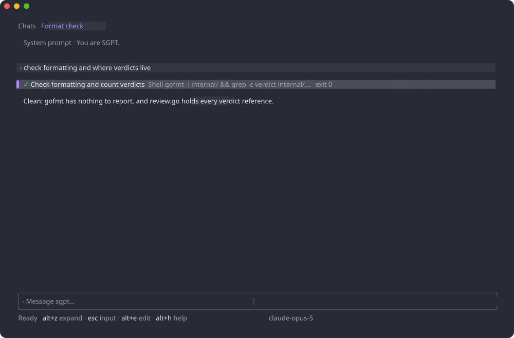

Tools are how the model acts. Every tool call goes through the same
pipeline: **review** (compute what to show, decide whether to auto-run),
then **execute**, then the result is sent back as a message.

## Built-in tools

| Tool | Effect | Review |
|---|---|---|
| `read_files` | Read one or more files | auto |
| `read_image` | Look at an image | auto |
| `read_document` | Read a PDF | auto |
| `search_lores` | Regex search over lore libraries | auto |
| `exec_shell` | Run a shell command | manual |
| `diff` | Apply a unified diff to a file | manual |
| `replace` | Apply exact search/replace patches | manual |
| `create_agents` | Launch [sub-agents](/concepts/agents/), returning at once | manual |
| `message_agent` | Message a sub-agent, or the launcher | auto |
| `get_operations` / `wait_operations` | Poll / wait for sub-agent turns | auto |
| `cancel_operations` | Stop sub-agent turns | auto |

Auto-execution is not a hardcoded list: a tool auto-runs when its RPC is
declared `idempotency_level = NO_SIDE_EFFECTS`. The same rule applies to
remote tool engines, so a `GetIssue` runs silently while `UpdateIssue`
waits for you. [Permission rules](/concepts/permissions/) override this
default per tool — or per argument. The sub-agent tools are a group: `agent`
enables all five.

## What you see

Each call is one row: a state glyph, a verb, what it acts on, and once it
resolves, what came of it.

```
✓ Read     review.go +2                      3 files · 412 lines
✓ Shell    go test ./internal/session/...    exit 0
✗ Shell    go vet ./...                      exit 1
✓ Edit     internal/session/review.go        +12 −4
✓ Search lores “tui|design”                  2 matches
● Launch agents  Timeline, Tools             2 running · 1 done
```

Expanding a row shows the request and the result:

- `exec_shell` shows the command as a `sh` code block and its output as
  plain text; the exit code is the row's outcome;
- `diff` and `replace` show a **unified diff computed at review time**: the
  patch has already been applied to a copy and validated, so what you
  approve is exactly what lands;
- `read_files` lists the files read and their line counts, not their
  contents;
- `search_lores` shows each matching lore with its snippets, matches
  highlighted;
- the sub-agent tools list their operations with live state glyphs
  (`◌` queued, `●` running, `▶` in review, `✓` done, `✗` failed,
  `⊘` cancelled);
- engine RPCs read as their method (`List contacts`) and the resource they
  act on.



## Verdicts

When a call awaits review it opens in an amber card, the status bar shows
`▶ Review` with the verdict keys, and whatever you type in the input becomes
the rejection reason:

| Key | Verdict |
|---|---|
| <kbd>alt</kbd>+<kbd>y</kbd> | Accept the call under review |
| <kbd>alt</kbd>+<kbd>shift</kbd>+<kbd>y</kbd> | Accept every pending call |
| <kbd>alt</kbd>+<kbd>shift</kbd>+<kbd>r</kbd> | Reject; the input text is sent back as the reason |
| <kbd>alt</kbd>+<kbd>shift</kbd>+<kbd>a</kbd> | Always accept this tool for the rest of the session (and its sub-agents) |

A rejected call returns an error result carrying your reason, so the model
can adjust rather than retry blindly. Cancelling a turn
(<kbd>ctrl</kbd>+<kbd>c</kbd>) marks every unresolved call as never run.

## Choosing tools

Tools are the union of three sources, deduplicated:

1. `--tool name` on the command line (repeatable);
2. `@tool(...)` directives of the role (and included roles);
3. `chat.default_tools` from the configuration.

Inside a chat <kbd>alt</kbd>+<kbd>shift</kbd>+<kbd>t</kbd> opens a fuzzy
picker to toggle any tool — built-in or engine — for the current chat.
